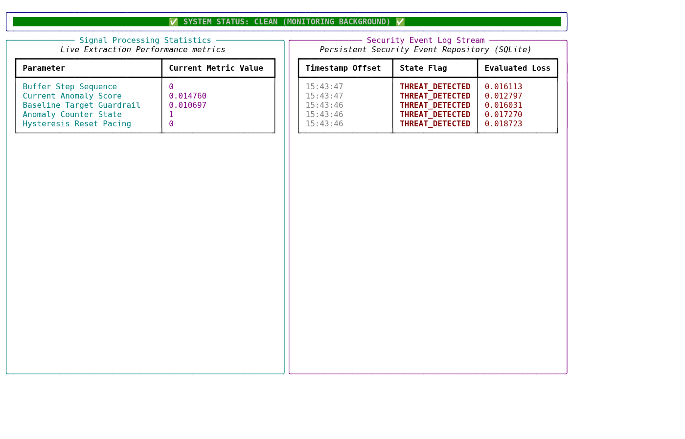
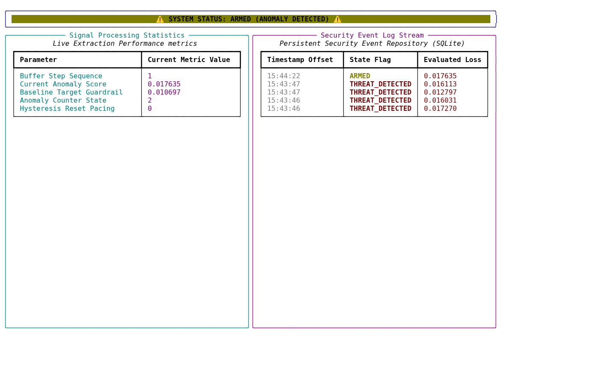
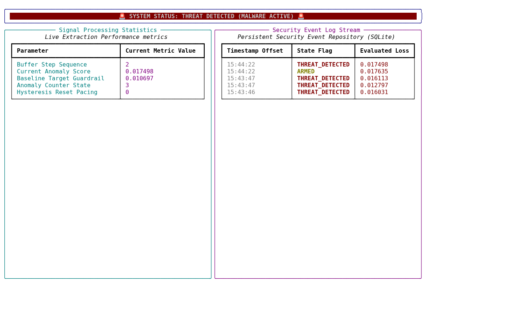

# AetherHound

Detects simulated RF and acoustic covert channels in an air-gapped-room scenario. The default workflow is entirely software-only: WAV fixtures act as a virtual microphone and optional generated IQ acts as a virtual RF receiver. No Raspberry Pi, SDR, microphone, or other hardware is required.

## Architecture

```
AetherHound/
├── capture/           # Real and virtual signal sources
│   ├── record_audio.py      # Legacy audio capture
│   ├── live_audio.py        # Live microphone callback queue
│   ├── simulated_audio.py   # Deterministic WAV-backed virtual microphone
│   ├── rf_source.py         # RF backend abstraction (RTL-SDR, HackRF, simulated)
│   ├── record_rf.py         # RF baseline calibration
│   ├── sweep.py             # Wideband sweep step builder + engine
│   ├── bearing.py           # RSSI-peak direction finding
│   └── rack_localization.py # Virtual-mic-array rack estimation from amplitude ratios
├── dsp/               # Signal processing pipeline
│   ├── pipeline.py          # Audio: bandpass + notches + STFT (cached SOS)
│   ├── features.py          # Gain-resistant tonal-prominence feature
│   ├── keying.py            # On/off keying detector (rejects steady hum/blips)
│   ├── morse.py             # Real Morse timing: encode text, decode it back
│   ├── streaming.py         # Shared live/calibration patch assembly
│   ├── patch_generator.py   # 64-frame patch slicing
│   └── rf_pipeline.py       # RF: IQ -> dB spectrum, decimation, peak search
├── native/            # Opt-in C port of averaged_spectrum + honest benchmark (not wired into the live path)
├── gnuradio/          # Reference GNU Radio Companion flowgraph (standalone, not the live path)
├── train/             # Model training & calibration
│   ├── model.py             # AudioAutoencoder architecture
│   ├── run_training.py      # Training loop (fixed reference scale, augmented gains, grouped held-out split)
│   ├── calibrate_threshold.py  # Matching AE + tonal calibration
│   └── calibrate_room.py    # Separate real-microphone room profile
├── export/            # ONNX export
│   └── export_onnx.py       # Self-contained ONNX (external_data=False)
├── infer/             # Live detection engines
│   ├── detector.py          # Audio: ONNX runtime + hysteresis + SQLite
│   └── rf_detector.py       # RF: z-score baseline + peak freq + SQLite
├── ui/                # Terminal dashboard
│   ├── dashboard.py         # Legacy Rich Live split-screen UI
│   ├── waterfall.py         # Truecolour RF waterfall
│   └── alert.py             # Non-blocking buzzer thread
├── deploy/            # Production runner
│   └── run_app.py           # Virtual dashboard, 30 FPS, waterfall, event log
├── tests/             # Pytest validation
│   ├── conftest.py          # Generates data/ fixtures if missing (fresh-clone bootstrap)
│   ├── test_core.py         # Audio DSP + state machine
│   ├── test_rf.py           # RF spectrum + waterfall
│   ├── test_sweep.py        # Sweep step builder tests
│   ├── test_rf_mofn.py      # RF M-of-N confirmation (bursty/duty-cycled carriers)
│   ├── test_bearing.py      # Bearing estimation tests
│   ├── test_keying.py       # On/off keying detector (dsp/keying.py)
│   ├── test_training_split.py # Group-independent held-out split (needs requirements-train.txt)
│   ├── test_virtual_detection.py # Virtual-source and detection regressions
│   ├── test_morse.py        # dsp/morse.py encode/decode (pure numpy, no scipy/torch)
│   ├── test_rack_localization.py # capture/rack_localization.py (pure numpy)
│   └── test_native_averaged_spectrum.py # native/ C port vs. reference (skips if not built)
├── mock/              # Synthetic data generator
│   └── generate_signals.py  # Seeded RNG (deterministic); infected=True now keys real Morse timing
├── tools/
│   ├── bootstrap.sh              # Generates data/ fixtures for a fresh clone (see tests/conftest.py)
│   ├── export_events.py          # events.db -> CSV/JSONL
│   ├── decode_morse_attack.py    # Proves the Morse payload end to end against the real pipeline
│   └── demo_rack_localization.py # Demo: pin a THREAT_DETECTED event to a virtual rack
├── config.toml        # All hyperparameters (now actually parsed)
├── config_loader.py   # Typed config loader
├── requirements.txt   # Runtime dependencies (see also requirements-train.txt, requirements-dev.txt)
└── models/            # Trained artifacts (tracked via Git LFS)
    ├── autoencoder.pt
    ├── autoencoder.onnx
    ├── threshold.txt
    ├── tone_threshold.txt
    └── rf_baseline.npz
```

## Quick Start

```bash
# 1. Setup environment
python3 -m venv .venv
source .venv/bin/activate
pip install -r requirements.txt          # runtime only (no torch/CUDA)
pip install -r requirements-dev.txt      # add this too if you want to run the tests
# pip install -r requirements-train.txt  # add this only if you plan to retrain (pulls in torch)

# 2. Generate the synthetic audio + patch fixtures. data/ is gitignored (it's
#    all regenerable from a seeded RNG), so a fresh clone has none of it yet.
#    `pytest -q` also does this automatically via tests/conftest.py, so this
#    step is only needed if you want to run steps 4/5 without running pytest first.
./tools/bootstrap.sh

# 3. Verify the supplied trained model (models/autoencoder.onnx, tracked via
#    Git LFS) against the fixtures just generated
python deploy/run_app.py --self-test
pytest -q

# 4. Open the 30 FPS terminal dashboard on a clean virtual room
python deploy/run_app.py --scenario baseline

# 5. Run the simulated covert-channel attack
python deploy/run_app.py --scenario attack

# 6. A repeatable, text-only demonstration for a report or screen recording
python deploy/run_app.py --scenario attack --no-ui --duration 5

# 7. Optional: display the fully virtual RF waterfall and injected carrier
python deploy/run_app.py --scenario attack --simulated-rf --inject

# 8. Recalibrate only after replacing the clean baseline fixture
python train/calibrate_threshold.py
```

`--source simulation` is the default. `--source microphone`, `--buzzer`, and `--list-devices` are opt-in compatibility paths; they are not part of the software-only project demo.

## Optional Real-Room Demo Profile

The project can also demonstrate a laptop microphone without changing any virtual model or threshold. First create a separate room profile. During this 45-second recording, keep the sounds you want to be treated as normal present: usual room/fan noise, speech, and a short sample of ordinary music.

```bash
# Creates models/profiles/room.json; virtual artifacts remain unchanged.
python train/calibrate_room.py --seconds 45

# Opens the calibrated live-microphone dashboard.
python deploy/run_app.py --source microphone --profile room
```

The room profile is environment-specific. If a normal sound repeatedly raises an alert, rerun calibration with that normal sound included. Use `--profile virtual` or omit `--profile` to return to the fixed virtual demonstration at any time.

## Current Validation

The old result claiming 2 detections out of 468 attack patches is obsolete. It came from a deployment-time normalization mismatch: training used the saved fixed reference scale, while live inference re-normalized every patch by its own peak.

The runtime and calibration now both use `models/ref_scale.txt`. The calibrated fixtures produce no baseline breaches and 936/936 attack-patch detections. A second, independent tonal-prominence guard flags the narrow carrier itself and records its peak frequency. The regression suite covers virtual-source, model-separation, room-profile, keying, Morse encode/decode, and rack-localization checks (`pytest -q` for the current count -- it's grown across several review passes, so treat any specific number here as stale).

## Configuration

All parameters in `config.toml` (now actually parsed by `config_loader.py`):

- **Audio**: 48 kHz virtual microphone, 1024-sample blocks
- **Bandpass**: 20–22000 Hz (ultrasonic capable)
- **Notch filters**: 50 Hz base × 8 harmonics, Q=30
- **DSP**: nfft=512, hop=32, patch=64
- **Detection**: ONNX reconstruction score plus calibrated tonal prominence; filter warm-up prevents an initial false alarm
- **RF**: disabled by default; `--simulated-rf` enables only the synthetic source
- **Waterfall**: 108×26, -85 to -25 dB
- **UI**: Rich terminal dashboard at 30 Hz, with state, AE score, tonal prominence, peak frequency, and waterfall; state changes are retained in SQLite

## RF Layer

The project demo uses `SimulatedBackend`, which generates a noise floor and an optional injected carrier. `infer/rf_detector.py` scores each virtual spectrum against the saved virtual baseline and the terminal UI renders the waterfall. Run it with `--simulated-rf --inject`; it does not attempt to open an SDR.

Limits, stated plainly:
- The RF view is a simulated signal visualisation, not physical localisation.
- The acoustic detector reports the narrow-band peak frequency directly. Pinning that to a specific rack is a separate, explicitly virtual estimate -- see "Virtual rack localization" below -- not a claim of real multi-mic hardware localisation in a no-hardware build.

## Project 2 Brief: Gaps Closed After the Review

The November 2026 project review (`AetherHound Project Review.pdf`) listed several places this project didn't yet match the brief. This pass closed the remaining ones; each is stated plainly below, including what's genuinely demonstrated vs. what's still a simulation.

- **Mock malware now sends a real Morse payload.** `mock/generate_signals.py`'s simulated attack keys its 4 kHz covert tone with actual Morse timing (`dsp/morse.py`), not a flat on/off toggle -- it repeats "SOS" for the duration of the clip. `dsp/morse.py` can also decode a message back from a sequence of per-patch tone-presence decisions; `tools/decode_morse_attack.py` runs that against the real calibrated pipeline and `data/test_patches.npy`. `mock/fan_morse.py` (the real-hardware CPU/fan demo) already did real Morse timing; this brings the virtual/simulated attack path in line with it.
- **Virtual rack localization.** `capture/rack_localization.py` simulates a small server room (4 racks, 3 virtual mics by default) with distance-based amplitude attenuation, and estimates which rack a source is at from the *ratios* of amplitude across mics (scale-invariant, so the source's unknown loudness doesn't matter -- only how it splits across mics). Run `python -m capture.rack_localization` for a ground-truth self-check, or `python tools/demo_rack_localization.py` to pin the most recent `THREAT_DETECTED` event to a rack. This is a placement estimate over simulated distances, not real multi-mic hardware localisation -- there's still only one virtual microphone in this project.
- **Measured UI frame rate.** `deploy/run_app.py`'s footer used to echo `cfg.ui.refresh_hz` (the configured target) regardless of whether the loop was keeping up. It now also tracks actual loop-iteration timing over a trailing window and shows `measured/target fps`.
- **Plain-text event export.** `tools/export_events.py` exports `security_events` from SQLite to CSV and/or JSONL, with optional `--since`/`--state` filters, alongside the existing SQLite log.
- **Longer training audio.** `mock/generate_signals.py`'s augmented training set now generates 4 s recordings (was 2 s) -- about 13.3 minutes of underlying normal-hum audio at the default `num_samples=200`, up from ~6.7 minutes, and a long way up from the ~1 minute (1,404 patches) the review measured against the old single-clip baseline. Literal "hours" was considered and rejected: patches scale with total audio duration regardless of chunking, and the augmented set is already multi-gigabyte on disk at the current size -- see the comment above the `generate_training_dataset(...)` call in `mock/generate_signals.py` if you want to push this further and have the RAM/disk for it. **Retrain after regenerating data** (`./tools/bootstrap.sh && python train/run_training.py && python train/calibrate_threshold.py && python export/export_onnx.py`) for this to take effect.
- **GNU Radio flowgraph.** `gnuradio/aetherhound_dsp_demo.grc` is a reference flowgraph mirroring `dsp/pipeline.py`'s band-pass + mains-notch + FFT chain in stock GNU Radio Companion blocks. It's a standalone demo artifact, not part of the live Python path (which stays on scipy -- that's what's actually tested and calibrated). **It hasn't been opened in GNU Radio Companion** (no GUI/network in the environment that authored it) -- see `gnuradio/README.md` before relying on it.
- **C++ DSP port, benchmarked honestly.** `native/averaged_spectrum.c` is a hand-rolled C (ctypes, no pybind11/cmake) port of `dsp/rf_pipeline.py`'s `averaged_spectrum`. `native/bench_averaged_spectrum.py` compares it against the existing numpy/scipy implementation at the project's real sizes. At the actual RF config (`nfft=2048`, `frames_per_spectrum=4`), **the native port is slower**, matching the review's own profiling finding that FFT work is a minority of sweep time (~33%, vs. ~45% simulator RNG and ~19% a fixed sleep) -- so it's shipped as an opt-in, benchmarked artifact and is not imported anywhere in the live detection path. See `native/README.md`.

## Files

- `models/autoencoder.onnx` - ONNX export for inference (self-contained, no `.data` sidecar)
- `models/threshold.txt` - calibrated pre-margin autoencoder threshold
- `models/tone_threshold.txt` - calibrated narrow-band prominence threshold in dB
- `models/rf_baseline.npz` - RF per-bin mean/std baseline (committed via Git LFS)
- `events.db` - SQLite event log (audio + RF tables)
- `deploy/verified_receipt.txt` - Deployment verification

## Dashboard Screenshots

| State | Screenshot |
|-------|------------|
| CLEAN |  |
| ARMED |  |
| THREAT_DETECTED |  |
| FINAL |  |

## License

MIT
