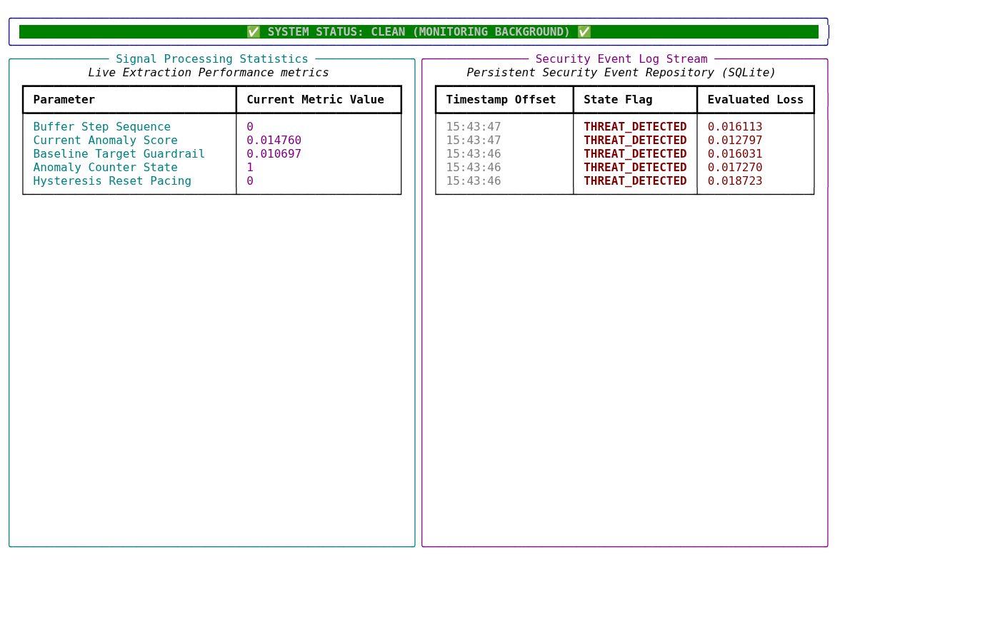
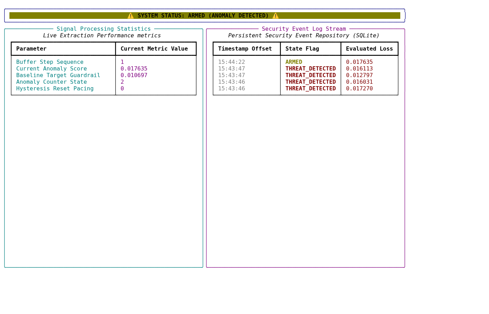
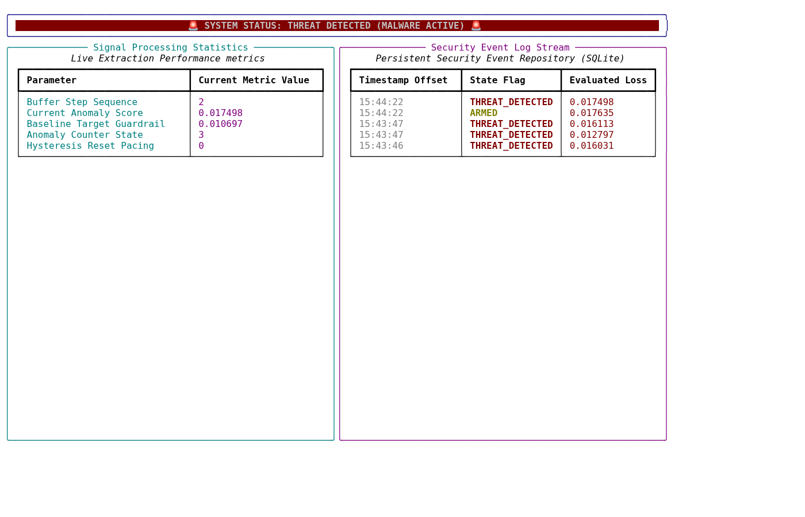

# AetherHound

Detects simulated RF and acoustic covert channels in an air-gapped-room scenario. The default workflow is entirely software-only: WAV fixtures act as a virtual microphone and optional generated IQ acts as a virtual RF receiver. No Raspberry Pi, SDR, microphone, or other hardware is required.

## Architecture

```
AetherHound/
├── capture/           # Real and virtual signal sources
│   ├── record_audio.py      # Legacy audio capture
│   ├── live_audio.py        # Live microphone callback queue
│   ├── simulated_audio.py   # Deterministic WAV-backed virtual microphone
│   ├── rf_source.py         # RF backend abstraction (RTL-SDR, HackRF, simulated)
│   ├── record_rf.py         # RF baseline calibration
│   ├── sweep.py             # Wideband sweep step builder + engine
│   └── bearing.py           # RSSI-peak direction finding
├── dsp/               # Signal processing pipeline
│   ├── pipeline.py          # Audio: bandpass + notches + STFT (cached SOS)
│   ├── features.py          # Gain-resistant tonal-prominence feature
│   ├── streaming.py         # Shared live/calibration patch assembly
│   ├── patch_generator.py   # 64-frame patch slicing
│   └── rf_pipeline.py       # RF: IQ -> dB spectrum, decimation, peak search
├── train/             # Model training & calibration
│   ├── model.py             # AudioAutoencoder architecture
│   ├── run_training.py      # Training loop (fixed reference scale)
│   ├── calibrate_threshold.py  # Matching AE + tonal calibration
│   └── calibrate_room.py    # Separate real-microphone room profile
├── export/            # ONNX export
│   └── export_onnx.py       # Self-contained ONNX (external_data=False)
├── infer/             # Live detection engines
│   ├── detector.py          # Audio: ONNX runtime + hysteresis + SQLite
│   └── rf_detector.py       # RF: z-score baseline + peak freq + SQLite
├── ui/                # Terminal dashboard
│   ├── dashboard.py         # Legacy Rich Live split-screen UI
│   ├── waterfall.py         # Truecolour RF waterfall
│   └── alert.py             # Non-blocking buzzer thread
├── deploy/            # Production runner
│   └── run_app.py           # Virtual dashboard, 30 FPS, waterfall, event log
├── tests/             # Pytest validation
│   ├── test_core.py         # Audio DSP + state machine
│   ├── test_rf.py           # RF spectrum + waterfall
│   ├── test_sweep.py        # Sweep step builder tests
│   ├── test_bearing.py      # Bearing estimation tests
│   └── test_virtual_detection.py # Virtual-source and detection regressions
├── mock/              # Synthetic data generator
│   └── generate_signals.py  # Seeded RNG (deterministic)
├── config.toml        # All hyperparameters (now actually parsed)
├── config_loader.py   # Typed config loader
├── requirements.txt   # Python dependencies
└── models/            # Trained artifacts (tracked via Git LFS)
    ├── autoencoder.pt
    ├── autoencoder.onnx
    ├── threshold.txt
    ├── tone_threshold.txt
    └── rf_baseline.npz
```

## Quick Start

```bash
# 1. Setup environment
python3 -m venv .venv
source .venv/bin/activate
pip install -r requirements.txt          # runtime only (no torch/CUDA)
pip install -r requirements-dev.txt      # add this too if you want to run the tests
# pip install -r requirements-train.txt  # add this only if you plan to retrain (pulls in torch)

# 2. Verify the supplied trained model and saved virtual fixtures
python deploy/run_app.py --self-test
pytest -q

# 3. Open the 30 FPS terminal dashboard on a clean virtual room
python deploy/run_app.py --scenario baseline

# 4. Run the simulated covert-channel attack
python deploy/run_app.py --scenario attack

# 5. A repeatable, text-only demonstration for a report or screen recording
python deploy/run_app.py --scenario attack --no-ui --duration 5

# 6. Optional: display the fully virtual RF waterfall and injected carrier
python deploy/run_app.py --scenario attack --simulated-rf --inject

# 7. Recalibrate only after replacing the clean baseline fixture
python train/calibrate_threshold.py
```

`--source simulation` is the default. `--source microphone`, `--buzzer`, and `--list-devices` are opt-in compatibility paths; they are not part of the software-only project demo.

## Optional Real-Room Demo Profile

The project can also demonstrate a laptop microphone without changing any virtual model or threshold. First create a separate room profile. During this 45-second recording, keep the sounds you want to be treated as normal present: usual room/fan noise, speech, and a short sample of ordinary music.

```bash
# Creates models/profiles/room.json; virtual artifacts remain unchanged.
python train/calibrate_room.py --seconds 45

# Opens the calibrated live-microphone dashboard.
python deploy/run_app.py --source microphone --profile room
```

The room profile is environment-specific. If a normal sound repeatedly raises an alert, rerun calibration with that normal sound included. Use `--profile virtual` or omit `--profile` to return to the fixed virtual demonstration at any time.

## Current Validation

The old result claiming 2 detections out of 468 attack patches is obsolete. It came from a deployment-time normalization mismatch: training used the saved fixed reference scale, while live inference re-normalized every patch by its own peak.

The runtime and calibration now both use `models/ref_scale.txt`. The calibrated fixtures produce no baseline breaches and 936/936 attack-patch detections. A second, independent tonal-prominence guard flags the narrow carrier itself and records its peak frequency. The regression suite has 23 tests, including virtual-source, model-separation, and room-profile checks.

## Configuration

All parameters in `config.toml` (now actually parsed by `config_loader.py`):

- **Audio**: 48 kHz virtual microphone, 1024-sample blocks
- **Bandpass**: 20–22000 Hz (ultrasonic capable)
- **Notch filters**: 50 Hz base × 8 harmonics, Q=30
- **DSP**: nfft=512, hop=32, patch=64
- **Detection**: ONNX reconstruction score plus calibrated tonal prominence; filter warm-up prevents an initial false alarm
- **RF**: disabled by default; `--simulated-rf` enables only the synthetic source
- **Waterfall**: 108×26, -85 to -25 dB
- **UI**: Rich terminal dashboard at 30 Hz, with state, AE score, tonal prominence, peak frequency, and waterfall; state changes are retained in SQLite

## RF Layer

The project demo uses `SimulatedBackend`, which generates a noise floor and an optional injected carrier. `infer/rf_detector.py` scores each virtual spectrum against the saved virtual baseline and the terminal UI renders the waterfall. Run it with `--simulated-rf --inject`; it does not attempt to open an SDR.

Limits, stated plainly:
- The RF view is a simulated signal visualisation, not physical localisation.
- The acoustic detector reports the narrow-band peak frequency. It does not claim to identify a physical server rack in a no-hardware build.

## Files

- `models/autoencoder.onnx` - ONNX export for inference (self-contained, no `.data` sidecar)
- `models/threshold.txt` - calibrated pre-margin autoencoder threshold
- `models/tone_threshold.txt` - calibrated narrow-band prominence threshold in dB
- `models/rf_baseline.npz` - RF per-bin mean/std baseline (committed via Git LFS)
- `events.db` - SQLite event log (audio + RF tables)
- `deploy/verified_receipt.txt` - Deployment verification

## Dashboard Screenshots

| State | Screenshot |
|-------|------------|
| CLEAN |  |
| ARMED |  |
| THREAT_DETECTED |  |
| FINAL |  |

## License

MIT
